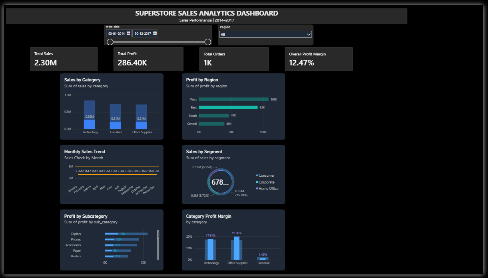

# Superstore Sales Analytics Dashboard

A Data Analyst portfolio project using PostgreSQL, Excel and Power BI to analyze sales performance, profitability, regional trends and business insights.

## Project Overview

This project analyzes the Sample Superstore dataset containing 9,994 records from 2014 to 2017.

The objective is to identify sales trends, evaluate profitability, compare product categories and regions, and provide actionable business insights through an interactive Power BI dashboard.

## Tools & Technologies

- PostgreSQL 18 – Data storage, cleaning and SQL analysis
- pgAdmin 4 – Database management
- Microsoft Excel – Data inspection
- Power BI Desktop – Interactive dashboard and visualization
- SQL – Data analysis and business insights

## Dataset

- Dataset: Sample Superstore
- Records: 9,994
- Period: 2014–2017
- Source: Kaggle Sample Superstore dataset

## Data Cleaning

- Imported 9,994 records into PostgreSQL.
- Created raw and cleaned tables.
- Checked duplicate records and missing values.
- Validated dates and numerical fields.
- Retained loss-making transactions.
- Created calculated columns for profit margin and shipping days.

## Key Performance Indicators

| Metric | Result |
|---|---:|
| Total Sales | $2,297,201.07 |
| Total Profit | $286,397.79 |
| Total Orders | 5,009 |
| Profit Margin | 12.47% |

## Key Business Insights

1. Technology generated the highest sales and profit among the three categories.
2. Furniture had the lowest profit margin at 2.49%.
3. The West region recorded the highest sales and profit.
4. Tables and Bookcases generated negative overall profit.
5. Higher discount levels were frequently associated with negative profits.
6. November 2017 recorded the highest monthly sales.

## Power BI Dashboard

The interactive dashboard includes:

- Total Sales
- Total Profit
- Total Orders
- Overall Profit Margin
- Sales by Category
- Profit by Region
- Monthly Sales Trend
- Sales by Segment
- Profit by Subcategory
- Profit Margin by Category
- Order Date and Region slicers

## Project Structure

```text
superstore-sales-dashboard/
│
├── data/
├── sql/
│   └── 01_sales_performance_analysis.sql
│
├── powerbi/
│   └── Superstore_Sales_Analytics_Dashboard.pbix
│
├── screenshots/
│   └── Dashboard/
│       └── Superstore_Dashboard.png
│
├── docs/
│
└── README.md
```

## How to Use This Project

1. Download the project repository.
2. Download the Sample Superstore dataset from Kaggle.
3. Create a PostgreSQL database named `superstore_db`.
4. Import the dataset and execute the SQL scripts.
5. Open the Power BI dashboard file.
6. Connect Power BI to the PostgreSQL database if prompted.
7. Explore the dashboard using the available slicers.

## Skills Demonstrated

- SQL querying and data analysis
- Data cleaning and validation
- PostgreSQL database management
- Business intelligence
- Power BI dashboard development
- Data visualization
- Business insights and reporting

## Author

**Rohit R**

Aspiring Data Analyst | SQL | Excel | Power BI | PostgreSQL
